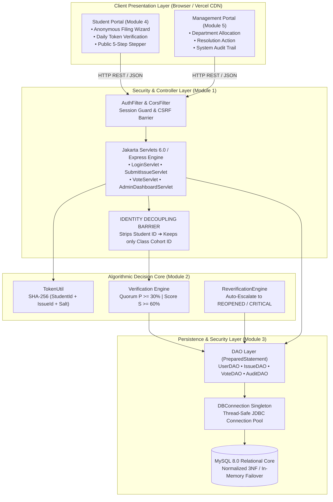
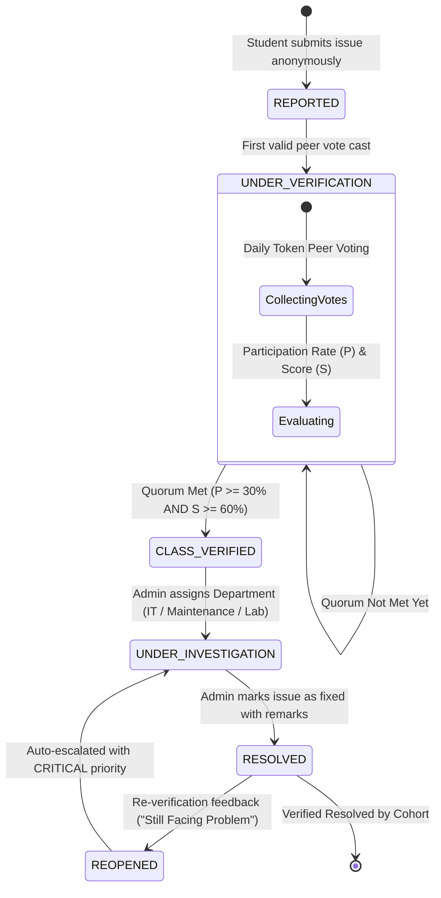
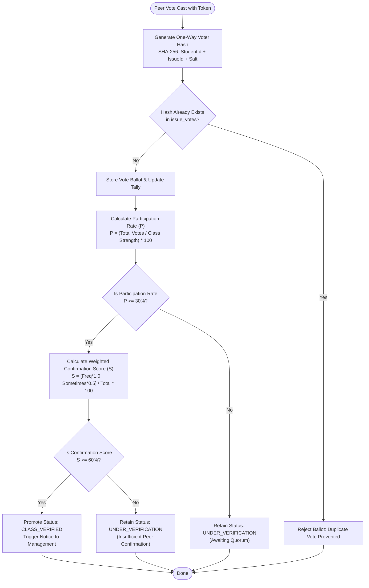
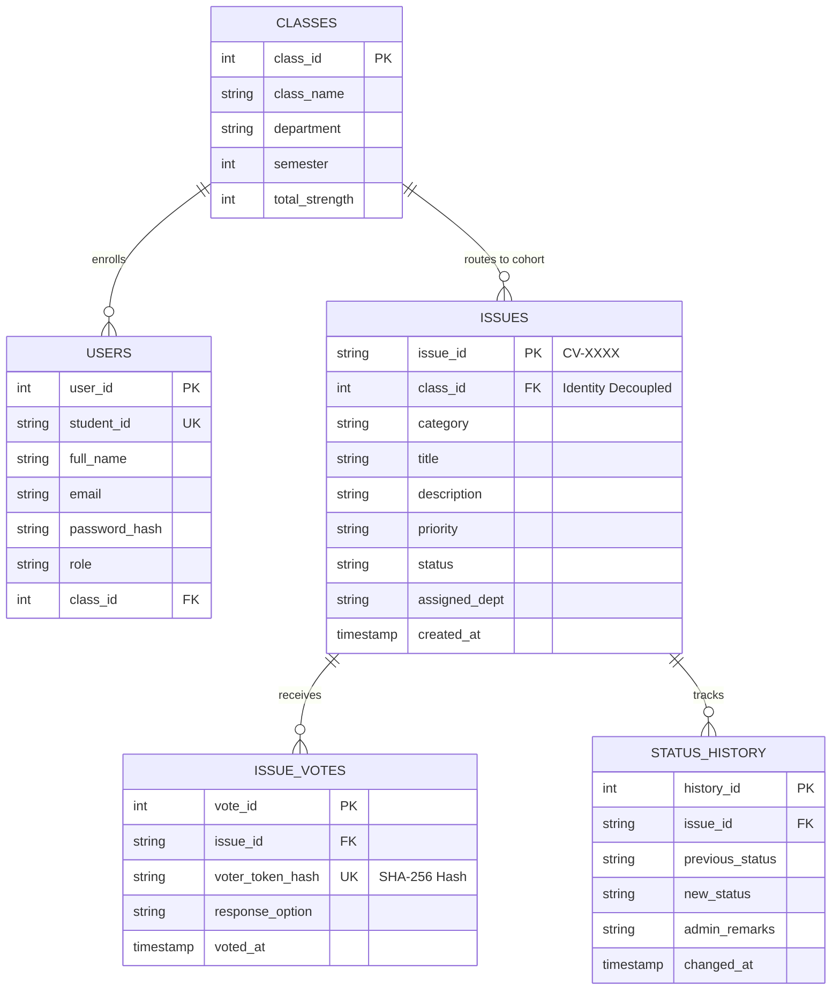
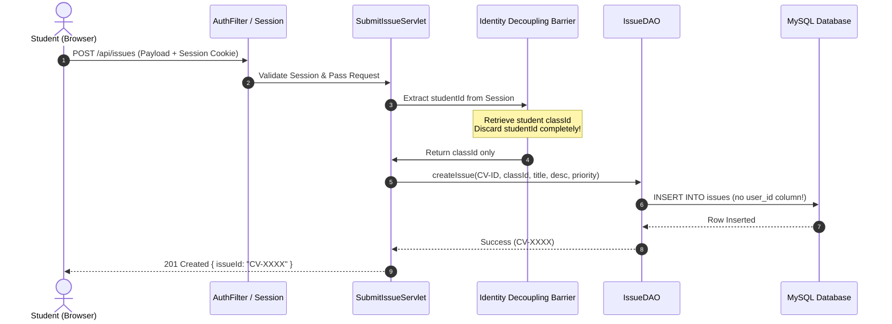
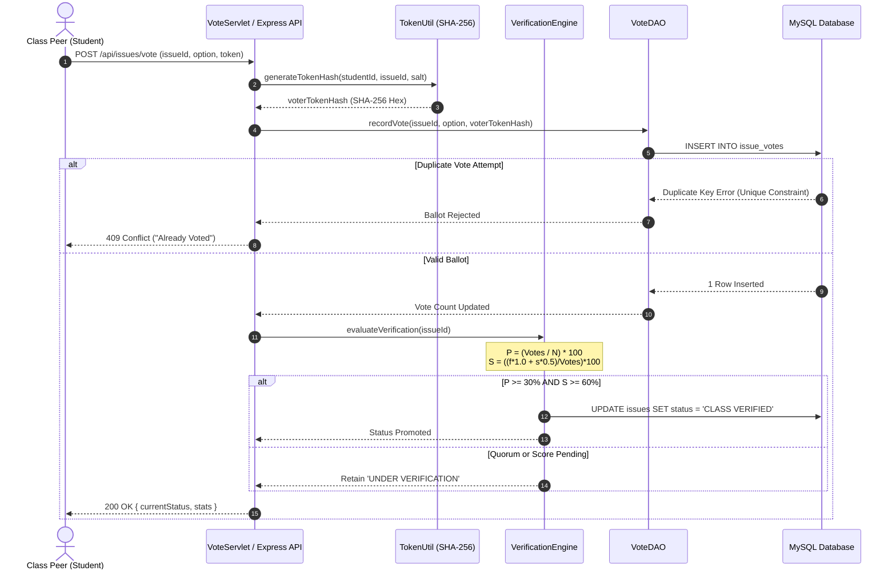

# CampusVoice — Anonymous Student Issue Reporting & Class-Level Verification System

[](#)
[](#)
[](#)
[](#)
[](#)
[](#)
[](#)
[](#)
[](#)

> **Live Production Server:** [https://webfinalporject.vercel.app](https://webfinalporject.vercel.app) *(Alternate Mirror: [https://campusvoice-web.vercel.app](https://campusvoice-web.vercel.app))*  
> **Secondary Cloud Deployment:** [https://campusvoice-web.onrender.com](https://campusvoice-web.onrender.com)

---

## 📌 Week 1: Project Administration & Foundation

### 1. Project Overview
- **Project Title:** CampusVoice — Anonymous Student Issue Reporting & Class-Level Verification System *(Academic Index: WORMS — Workflow-based Online Redressal & Monitoring System)*
- **Domain:** Educational Informatics, Cryptographic Anonymity, Algorithmic Verification & Institutional Governance
- **Academic Department:** Department of Artificial Intelligence and Data Science & Department of Computer Science and Engineering
- **Institutional Affiliation:** Rajasthan Technical University (RTU), Kota
- **Project Mentor:** **Er. Ram Babu Buri** *(Assistant Professor, Computer Science and Engineering Department)*
- **Technology Stack:**
  - **Backend Engines:** Java 17/21 (Jakarta Servlets 6.0, Apache Tomcat 10.1.60, JDBC Connection Pool), Node.js v18+/v20+ (Express 5.3 Full-Stack Engine)
  - **Persistence & Cryptography:** MySQL 8.0 (3NF Relational Schema), Fail-Safe In-Memory JSON Store, SHA-256 One-Way Voting Token Hashing, Salted Password Hashing, PreparedStatements (SQLi Immunity)
  - **Frontend Client:** Semantic HTML5, Modular CSS3 Design System (Glassmorphism, CSS Custom Properties `:root` Tokens, Flexbox, CSS Grid), Vanilla ECMAScript 2022 (Zero External UI Bloat)
  - **Deployment Infrastructure:** Vercel Production Serverless CDN, Render Cloud Web Service, Apache Tomcat Webapps WAR

---

### 2. Team Members
| S.No. | Student Name | RTU Roll No. | University Enrollment | Email Address | Mobile Contact |
|:---:|:---|:---:|:---:|:---|:---:|
| 1 | **Tanmay Baheti** | `24EARAD161` | `24E1ARADM40P161` | tanmaybaheti2005@gmail.com | +91 9511571986 |
| 2 | **Tavish Bhanawat** | `24EARAD163` | `24E1ARADM40P163` | tavishbhanawat@gmail.com | +91 8890628152 |
| 3 | **Twinkle** | `24EARAD165` | `24E1ARADF40P165` | kashyaptwinkle206@gmail.com | +91 8295950385 |
| 4 | **Yash Raj** | `24EARAD183` | `24E1ARADM40P183` | yashkumarafs43@gmail.com | +91 7667348426 |
| 5 | **Shivam Mishra** | `24EARAD150` | `24E1ARADM40P150` | shivammishra2k24@gmail.com | +91 8875246626 |

---

### 3. Module Ownership & Primary Responsibilities
| Team Member | Assigned Role / Domain | Project Subsystem | Primary Engineering Responsibilities |
|:---|:---|:---|:---|
| **Tavish Bhanawat** | Backend Architect & Auth Lead | **Module 1: Backend Architecture & Authentication** | Jakarta Servlets 6.0 MVC controllers, Apache Tomcat 10 setup, `web.xml`, session guards (`AuthFilter`, `CorsFilter`), Cryptographic Identity Decoupling Barrier, and immutable unified `ApiResponse<T>` payload protocol. |
| **Tanmay Baheti** | Algorithm & Core Logic Lead | **Module 2: Algorithm & Core Business Logic** | Verification Engine (`VerificationEngine.java`), democratic quorum ($P \ge 30\%$) & weighted affirmation score ($S \ge 60\%$), SHA-256 voting token hashing (`TokenUtil.java`), 6-stage lifecycle state machine, closed-loop re-verification engine, and JUnit test harness. |
| **Twinkle** | Database & Security Specialist | **Module 3: Database & Security Architecture** | Normalized 3NF MySQL schema, decoupled entity-relationship (ER) isolation, thread-safe JDBC connection pooling (`DBConnection.java`), DAO layer with PreparedStatements, audit trail tables, and SQL injection security suite (`DatabaseSecurityTestSuite.java`). |
| **Yash Raj** | Frontend Lead (Student Portal) | **Module 4: Frontend Student Portal** | Responsive Single-Page Application (HTML5/CSS3/ES6), anonymous complaint filing wizard (`modal-report`), single-use daily verification token widget (`CV1832026`), class voting modal (`modal-verify`), and 5-stage milestone stepper. |
| **Shivam Mishra** | Management Portal & System QA Lead | **Module 5: Management Portal & System QA** | Administrative command dashboard (`view-admin`), 6 institutional KPI metrics, department allocation workflow, status update dialogs, CSV archival data export, end-to-end integration test harness (`TestSuite.java`), and IEEE Std SRS / Project Documentation. |

---

### 4. Project Abstract
In higher education institutions, students routinely encounter legitimate academic, laboratory equipment, facility infrastructure, and administrative bottlenecks. However, fear of identity exposure, personal victimization, and institutional retribution severely hinders candid reporting. Conversely, academic administrations are routinely inundated with isolated, unverified, or frivolous individual complaints, making it difficult to allocate physical and financial resources to genuinely critical classroom-wide defects.

**CampusVoice** resolves this institutional deadlock through a dual-pillar socio-technical innovation:
1. **Cryptographic Identity Decoupling:** Architectural isolation between user authentication profiles and submitted grievance records. The backend strips personal credentials at the servlet gate, retaining only the class cohort identifier (`class_id`). No database record links a student's identity to an issue or a ballot, mathematically guaranteeing pre-image privacy.
2. **Democratic Class-Level Verification Engine:** A quorum-driven peer consensus algorithm requiring a minimum class participation rate ($P \ge 30\%$) and a weighted confirmation score ($S \ge 60\%$) based on peer feedback (*Frequently* = 1.0, *Sometimes* = 0.5, *Never* = 0.0). Individual complaints remain isolated until the class cohort democratically authenticates them.

Operating on a production-ready dual-stack architecture—a pure Java Jakarta Servlets MVC / Tomcat server alongside an asynchronous Node.js / Express web engine and a high-performance vanilla frontend—CampusVoice provides closed-loop grievance tracking. Featuring automated auto-reopening of unresolved issues with `CRITICAL` priority, tamper-proof audit trails, and institutional role-based access control, CampusVoice establishes a transparent, accountable, and democratic campus governance platform.

---

## 🏛️ Week 2: User Roles, Architecture & Core Modules

### 1. User Roles (Role-Based Access Control)
CampusVoice enforces strict Role-Based Access Control (RBAC) across client interfaces and server-side request filters:

1. **Student (`ROLE_STUDENT`):**
   - Authenticates using Student ID (e.g., `183`) and credentials.
   - Files anonymous grievances with categories, urgency levels, descriptions, and file evidence without leaving identity footprints.
   - Participates in daily peer verification voting on cohort grievances using one-way cryptographic tokens.
   - Provides post-resolution re-verification feedback (*Resolved Completely*, *Partially Resolved*, *Still Facing Problem*).
2. **System Administrator / HOD (`ROLE_ADMIN`):**
   - Accesses the centralized administrative dashboard via secure credentials (`admin` / `admin123`).
   - Evaluates democratically verified issues (`CLASS VERIFIED`) across institutional KPI counters.
   - Assigns issues to responsible campus departments (IT Cell, Electrical & Maintenance, Academic Dean Office, Hostel Administration, Canteen Board, Proctorial Board).
   - Updates investigation progress, enters official administrative commentary, signs off on resolutions, and exports full institutional CSV grievance datasets.
3. **Public / Unauthenticated Citizen (`ROLE_GUEST`):**
   - Accesses the public tracking engine directly from the landing page.
   - Queries real-time grievance trajectories via unique tracking tokens (e.g., `CV-1847`) with zero login requirements.

---

### 2. System Architecture & Core Modules


---

### 3. Functional Subsystems Breakdown

#### Subsystem 1: Backend Architecture & Authentication (Tavish Bhanawat)
- Implements pure Java Jakarta Servlet 6.0 controllers routing incoming HTTP actions.
- Configures Apache Tomcat 10 deployment descriptors (`web.xml`), servlet mappings, and HTTP-only session cookies.
- Intercepts requests via `AuthFilter` (role authorization), `CorsFilter` (cross-origin validation), `EncodingFilter` (UTF-8), and `LoggingFilter`.
- Enforces the server-side **Identity Decoupling Barrier**: extracts the student's `classId` from session and immediately discards `studentId` before invoking business logic.

#### Subsystem 2: Algorithmic Core & State Machine (Tanmay Baheti)
- Evaluates peer ballots via the mathematical Verification Engine (`VerificationEngine.java`).
- Computes single-use cryptographic token hashes: $\text{TokenHash} = \text{SHA-256}(\text{StudentId} \,\|\, \text{IssueId} \,\|\, \text{Salt})$.
- Governs the 6-state deterministic lifecycle state machine (`REPORTED` $\to$ `UNDER_VERIFICATION` $\to$ `CLASS_VERIFIED` $\to$ `UNDER_INVESTIGATION` $\to$ `RESOLVED` / `REOPENED`).
- Executes closed-loop post-resolution re-verification; negative feedback (*Still Facing Problem*) triggers automatic status transition to `REOPENED` with `CRITICAL` priority.

#### Subsystem 3: Database & Cryptographic Security (Twinkle)
- Authors 3NF normalized MySQL 8.0 schema with foreign key cascades, unique ballot constraints, and composite indexes on `(status, class_id)`.
- Delivers thread-safe singleton JDBC connection pooling (`DBConnection.java`) with connection reuse and resource release.
- Constructs parameterized DAO layer (`UserDAO`, `IssueDAO`, `VoteDAO`, `StatusHistoryDAO`) guaranteeing SQL injection immunity.
- Secures passwords using salted SHA-256 hashing (`PasswordUtil.java`) and maintains tamper-proof audit trails.

#### Subsystem 4: Frontend Presentation & Interaction (Yash Raj)
- Builds responsive Single-Page Application (SPA) architecture in pure semantic HTML5, CSS3, and vanilla JavaScript.
- Implements the Anonymous Grievance Filing Wizard (`modal-report`) with category routing and live 500-character countdown.
- Develops the Peer Voting Modal (`modal-verify`) with live participation meters and daily verification token display (`CV1832026`).
- Embeds the visual 5-Stage Milestone Stepper (`modal-track`) displaying live progress tags and administrative notes.

#### Subsystem 5: Management Command Center & System QA (Shivam Mishra)
- Engineers the Administrative Management Dashboard (`view-admin`) with 6 institutional KPI metric counters.
- Provides department routing interface mapping complaints to specific administrative departments.
- Implements resolution update dialogs, official remark logging, and 1-click CSV archival data export.
- Authors the end-to-end automated test harness (`TestSuite.java`) and compiles project documentation (IEEE Std SRS and Final Project Report).

---

### 4. Database Architecture & Resiliency Strategy
1. **Production Relational Core (MySQL 8.0):**
   - Normalized 3NF entity tables (`users`, `classes`, `issues`, `issue_votes`, `issue_evidence`, `status_history`, `audit_trail`).
   - Time-series B-Tree indexes on `(status, class_id)` ensuring sub-millisecond retrieval.
   - Strict unique constraint `UNIQUE(issue_id, voter_token_hash)` on the ballot table preventing double-voting without voter logging.
2. **Fail-Safe In-Memory / File Persistence:**
   - Zero-configuration runtime failover to `data/campusvoice_db.json` when running in standalone Node.js environments or serverless deployments (Vercel).
   - Auto-seeding with standard baseline issues (`CV-1847`, `CV-4821`, `CV-7392`, `CV-2950`, `CV-5120`), test student accounts, and admin profiles.

---

### 5. Non-Functional Requirements
- **Security:** Zero identity linkage between complaints and users; salted SHA-256 password storage; SQL injection immunity via JDBC `PreparedStatement`.
- **Performance:** Sub-10ms algorithmic execution for verification checks; API response times under 150ms; zero-bundle frontend loading in under 300ms.
- **Reliability:** Dual-stack execution (Java Tomcat WAR & Node.js Express); graceful failover from MySQL to file/memory storage.
- **Portability:** Production deployment on Vercel CDN and Render Cloud; local cross-platform support across Windows, macOS, and Linux.

---

## 📐 Week 3: UML Design & System Modeling

### 1. Issue Lifecycle State Machine Diagram


---

### 2. Democratic Verification Algorithm Flowchart


---

### 3. Decoupled Entity-Relationship (ER) Architecture


---

### 4. UML Sequence Diagram: Anonymous Issue Submission & Identity Decoupling


---

### 5. UML Sequence Diagram: Peer Verification & Algorithmic Promotion


---

## 📅 Detailed 13-Week Work Distribution & Member Deliverables

The CampusVoice project executed across a disciplined **13-week engineering lifecycle** from **6 July 2026 to 6 October 2026**. Below is the exhaustive weekly contribution mapping for all five team members:

### Week 4: Core Foundations, Database Layer & Persistence (July 27 – August 2)
**Objective:** Initialize the core web layout, configure Apache Tomcat deployment descriptors, implement database connectivity pooling, and configure authentication filter guards.
| Team Member | Domain / Module | Week 4 Tasks & Focus Areas | Deliverable |
|:---|:---|:---|:---|
| **Tavish Bhanawat** | Backend Architecture & Auth | Implemented `AuthFilter.java` for session validation and URL route protection. Configured `web.xml` context parameters. | Working Authentication Filter & Session Guard |
| **Tanmay Baheti** | Algorithm & Core Logic | Developed `IssueIdGenerator.java` creating cryptographically strong alphanumeric tracking keys (`CV-XXXX`). | Cryptographic Issue ID Generator Utility |
| **Twinkle** | Database & Security | Implemented thread-safe singleton connection manager `DBConnection.java` with Hikari/JDBC pooling parameters. | Tested Thread-Safe JDBC Connection Pool |
| **Yash Raj** | Frontend Student Portal | Built responsive master layout skeleton in `index.html` with student profile card and navigation header. | Semantic Student Dashboard Web Layout |
| **Shivam Mishra** | Management Portal & System QA | Formulated administrative review process flows, department routing hierarchy, and testing milestone matrices. | Documented Administrative Routing Spec |

---

### Week 5: Identity Decoupling, Verification Math & Issue Filing (August 3 – August 9)
**Objective:** Implement server-side identity decoupling in issue servlets, author the mathematical quorum formula, build the complaint filing wizard, and construct the `IssueDAO` layer.
| Team Member | Domain / Module | Week 5 Tasks & Focus Areas | Deliverable |
|:---|:---|:---|:---|
| **Tavish Bhanawat** | Backend Architecture & Auth | Built `SubmitIssueServlet.java` with strict identity stripping mechanism isolating student profiles from issue models. | Identity-Decoupled Issue Submission Servlet |
| **Tanmay Baheti** | Algorithm & Core Logic | Implemented `VerificationEngine.java` core quorum ($P \ge 30\%$) and weighted score ($S \ge 60\%$) decision routines. | Mathematical Verification Decision Engine |
| **Twinkle** | Database & Security | Implemented `IssueDAO.java` and `ClassDAO.java` utilizing `PreparedStatement` with zero foreign key linkage to user profiles. | Parameterized Issue Persistence DAO Layer |
| **Yash Raj** | Frontend Student Portal | Built Anonymous Grievance Filing Wizard (`modal-report`) with category pickers, urgency dropdowns, and 500-char counter. | Interactive Grievance Filing Modal UI |
| **Shivam Mishra** | Management Portal & System QA | Drafted midterm project presentation deck and verified IEEE SRS Section 3 functional requirements. | Verified Functional Requirements Specification |

---

### Week 6: Class Cohort Routing, Ballot Deduplication & Voting UI (August 10 – August 16)
**Objective:** Build cohort-based issue routing, enforce unique voter hash constraints, trigger automated evaluation per ballot, and develop the peer voting interface.
| Team Member | Domain / Module | Week 6 Tasks & Focus Areas | Deliverable |
|:---|:---|:---|:---|
| **Tavish Bhanawat** | Backend Architecture & Auth | Implemented `FetchClassIssuesServlet.java` routing grievances to matching student class cohorts. | Class Cohort Feed Query Controller |
| **Tanmay Baheti** | Algorithm & Core Logic | Built `TriggerService.java` to invoke verification algorithms automatically upon receipt of every incoming peer ballot. | Event-Driven Verification Trigger Service |
| **Twinkle** | Database & Security | Created `VoteDAO.java` enforcing strict database constraint `UNIQUE(issue_id, voter_token_hash)` against double-voting. | Duplicate-Resistant Ballot Persistence DAO |
| **Yash Raj** | Frontend Student Portal | Designed Anonymous Class-Level Voting Modal (`modal-verify`) with live meters (*Frequently*, *Sometimes*, *Never*). | Animated Peer Voting Dialog Interface |
| **Shivam Mishra** | Management Portal & System QA | Configured automated test runner and wrote test stubs for issue submission and voting boundary cases. | Automated Unit Test Harness Stubs |

---

### Week 7: One-Way Token Hashing, Test Harness & Daily Shield (August 17 – August 23)
**Objective:** Program one-way voting token hashing, execute comprehensive algorithmic JUnit test suites, build the daily voting token shield card, and conduct mid-term quality audits.
| Team Member | Domain / Module | Week 7 Tasks & Focus Areas | Deliverable |
|:---|:---|:---|:---|
| **Tavish Bhanawat** | Backend Architecture & Auth | Developed `VoteServlet.java` handling ballot submission, token verification, and unified JSON response dispatching. | Secure Ballot Submission Controller |
| **Tanmay Baheti** | Algorithm & Core Logic | Authored JUnit test harness `AlgorithmTest.java` evaluating 20+ voting vectors (boundary scores, ties, small classes). | Comprehensive Algorithmic JUnit Test Suite |
| **Twinkle** | Database & Security | Implemented `EvidenceDAO.java` handling file attachment metadata and image persistence links. | Evidence & Attachment Metadata DAO |
| **Yash Raj** | Frontend Student Portal | Built Daily Token Shield Card (`CV1832026`) featuring 1-click token copy, status badges, and demo reset controls. | Daily Voting Token Shield UI Widget |
| **Shivam Mishra** | Management Portal & System QA | Executed mid-term quality assurance sprint; logged issue tracking bug reports and verified session persistence. | Mid-Term QA Report & Defect Log |

---

### Week 8: Public Tracking, Closed-Loop Re-verification & Visual Stepper (August 24 – August 30)
**Objective:** Expose unauthenticated public tracking APIs, engineer closed-loop re-verification logic, design audit trail tables, and construct the 5-stage milestone stepper.
| Team Member | Domain / Module | Week 8 Tasks & Focus Areas | Deliverable |
|:---|:---|:---|:---|
| **Tavish Bhanawat** | Backend Architecture & Auth | Implemented `TrackIssueServlet.java` supporting public unauthenticated lookups by CV-ID. | Public Tracking REST API Controller |
| **Tanmay Baheti** | Algorithm & Core Logic | Engineered `ReverificationEngine.java` for post-resolution closed-loop feedback and auto-reopening. | Closed-Loop Re-verification Engine |
| **Twinkle** | Database & Security | Designed `status_history` and `audit_trail` tables with timestamped transition tracking. | Immutable System Audit Logging Schema |
| **Yash Raj** | Frontend Student Portal | Built 5-Stage visual milestone stepper (`modal-track`) with color indicators and department tags. | Visual 5-Stage Milestone Stepper UI |
| **Shivam Mishra** | Management Portal & System QA | Designed Management Web Dashboard layout, KPI metric counter cards, and administrative review queues. | Management Dashboard UI Layout Structure |

---

### Week 9: Admin Dashboard Controllers, Threshold Tuning & History DAO (August 31 – September 6)
**Objective:** Implement admin issue filtering servlets, tune institutional quorum thresholds, build status transition history DAOs, and construct department assignment dialogs.
| Team Member | Domain / Module | Week 9 Tasks & Focus Areas | Deliverable |
|:---|:---|:---|:---|
| **Tavish Bhanawat** | Backend Architecture & Auth | Implemented `AdminDashboardServlet.java` and multi-parameter filtering endpoints (`category`, `status`, `priority`). | Admin Filtering & Metrics Controller |
| **Tanmay Baheti** | Algorithm & Core Logic | Calibrated algorithm participation quorum ($30\%$) and verified whole-number arithmetic check $(2f + s) \times 5 \ge 6t$. | Calibrated Algorithmic Verification Rules |
| **Twinkle** | Database & Security | Implemented `StatusHistoryDAO.java` to record all timestamped transitions, previous statuses, and admin remarks. | State Transition History DAO |
| **Yash Raj** | Frontend Student Portal | Integrated Re-Verification Feedback Modal (`modal-reverify`) allowing students to report recurring issues. | Student Re-Verification Feedback Dialog |
| **Shivam Mishra** | Management Portal & System QA | Implemented administrative department allocation and status transition action modals in the management portal. | Department Allocation Action Dialog |

---

### Week 10: Department Assignment, Auto-Escalation & Security Test Harness (September 7 – September 13)
**Objective:** Program department dispatching servlets, implement auto-escalation to `CRITICAL` priority upon negative feedback, author SQL injection security test suites, and build theme engines.
| Team Member | Domain / Module | Week 10 Tasks & Focus Areas | Deliverable |
|:---|:---|:---|:---|
| **Tavish Bhanawat** | Backend Architecture & Auth | Developed `UpdateResolutionServlet.java` with role authorization checks for administrative status transitions. | Resolution & Department Dispatch Servlet |
| **Tanmay Baheti** | Algorithm & Core Logic | Implemented automated trigger promoting recurring unresolved issues directly to `CRITICAL` priority and `REOPENED` status. | Automated Priority Escalation Trigger |
| **Twinkle** | Database & Security | Authored `DatabaseSecurityTestSuite.java` validating database resistance against SQL injection and token spoofing. | Database Security & SQLi Test Suite |
| **Yash Raj** | Frontend Student Portal | Built instant Dark/Light mode theme switcher with `localStorage` persistence and high-contrast styling tokens. | Persistent Dark/Light Mode Theme Engine |
| **Shivam Mishra** | Management Portal & System QA | Implemented 1-click CSV grievance data export and real-time text search filters across administrative queues. | Administrative CSV Export & Search Bar |

---

### Week 11: Cross-Module Integration, CORS Wiring & System QA (September 14 – September 20)
**Objective:** Achieve full-system end-to-end integration across frontend views, security filters, servlets, and database pools; configure universal CORS; and execute full test suites.
| Team Member | Domain / Module | Week 11 Tasks & Focus Areas | Deliverable |
|:---|:---|:---|:---|
| **Tavish Bhanawat** | Backend Architecture & Auth | Implemented `CorsFilter.java` and `EncodingFilter.java` supporting cross-origin decoupled execution and UTF-8 charsets. | Cross-Origin CORS & Encoding Filter Engine |
| **Tanmay Baheti** | Algorithm & Core Logic | Integrated edge-case handling for small classes ($\text{min\_votes} = \min(\max(\lceil 0.3N \rceil, 5), N)$) and zero-vote guards. | Edge-Case Hardened Algorithmic Engine |
| **Twinkle** | Database & Security | Optimized relational queries with composite B-Tree indexes on `(status, class_id)` for sub-millisecond retrieval. | Optimized Composite Database Indexes |
| **Yash Raj** | Frontend Student Portal | Conducted UI responsiveness audits across mobile, tablet, and desktop viewports, certifying zero layout breakage. | Cross-Device Responsive UI Hardening |
| **Shivam Mishra** | Management Portal & System QA | Developed comprehensive automated system test suite `TestSuite.java` verifying 10 critical end-to-end test vectors. | End-to-End System Integration Test Suite |

---

### Week 12: Load Testing, Optimization, Technical Manuals & Viva Readiness (September 21 – September 27)
**Objective:** Execute Tomcat load testing, conduct algorithmic benchmark profiling, perform database backup and recovery drills, author technical documentation, and prepare viva defense scripts.
| Team Member | Domain / Module | Week 12 Tasks & Focus Areas | Deliverable |
|:---|:---|:---|:---|
| **Tavish Bhanawat** | Backend Architecture & Auth | Built `build.ps1` automated packaging script; executed Apache Tomcat load testing on servlet request pipelines. | Automated WAR Packaging Script & Load Benchmark |
| **Tanmay Baheti** | Algorithm & Core Logic | Benchmarked verification engine execution (sub-5ms processing per ballot); finalized mathematical proofs. | Algorithmic Profiling & Mathematical Proofs |
| **Twinkle** | Database & Security | Executed database backup and recovery drills; audited audit trail consistency; certified zero identity leakage. | Audited Database Recovery & Privacy Audit |
| **Yash Raj** | Frontend Student Portal | Polished micro-animations, loading spinners, modal transitions, and keyboard accessibility across all client forms. | Polished Client UI & Accessibility Standards |
| **Shivam Mishra** | Management Portal & System QA | Conducted regression testing across all evaluation vectors; authored user operating guide and interactive viva defense script. | System Regression Audit & Viva Demo Script |

---

### Week 13: Vercel CDN Deployment, Tomcat Packaging & Academic Sign-off (September 28 – October 6)
**Objective:** Finalize Tomcat deployment packages, deploy full-stack web application to Vercel production CDN, compile IEEE Std SRS, finalize presentation slide deck, and achieve academic sign-off.
| Team Member | Domain / Module | Week 13 Tasks & Focus Areas | Deliverable |
|:---|:---|:---|:---|
| **Tavish Bhanawat** | Backend Architecture & Auth | Finalized Tomcat server deployment archive `target/campusvoice.war` and environment configuration parameters. | Production Tomcat WAR Server Package |
| **Tanmay Baheti** | Algorithm & Core Logic | Completed algorithmic documentation, verification test case specifications, and pseudocode in module documentation. | Algorithmic Specification Documentation |
| **Twinkle** | Database & Security | Generated final database schema documentation, ER diagrams, and connection pooling tuning manual. | Final Database Schema & ERD Documentation |
| **Yash Raj** | Frontend Student Portal | Deployed frontend web application to Vercel production CDN; verified live URL endpoints and asset caching. | Active Vercel Production Deployment |
| **Shivam Mishra** | Management Portal & System QA | Finalized IEEE Std 830-1998 SRS report, authored presentation slides (PPT), and led final defense walkthrough. | IEEE SRS Report, Slide Deck & Academic Sign-off |

---

## 🔬 Mathematical Verification Algorithm & Proof

When a student casts a peer ballot on a reported issue $I$ originating from class cohort $C$:

### 1. Quorum Participation Rate ($P$):
$$P = \left( \frac{|V_I|}{N_C} \right) \times 100$$
Where:
- $|V_I|$ = Total valid, unique ballots cast for issue $I$ ($|V_I| = f + s + n$).
- $N_C$ = Total student strength of class cohort $C$.
- **Institutional Quorum Rule:**
  $$\text{Quorum Satisfied} \iff |V_I| \ge \min\left( \max\left( \lceil 0.30 \times N_C \rceil, 5 \right), N_C \right)$$
  *(Guarantees at least 30% participation, with an absolute floor of 5 votes for classes of standard size).*

### 2. Weighted Confirmation Score ($S$):
Each peer ballot carries an assigned scalar confirmation weight:
- $w(\text{Frequently}) = 1.0$ (Issue affects student on a regular basis)
- $w(\text{Sometimes}) = 0.5$ (Issue intermittently observed)
- $w(\text{Never}) = 0.0$ (Issue has not been observed / not a problem)

$$S = \left[ \frac{1.0 \times f + 0.5 \times s}{|V_I|} \right] \times 100$$
Where $f = \text{count}(\text{Frequently})$, $s = \text{count}(\text{Sometimes})$, $n = \text{count}(\text{Never})$.

### 3. Exact Whole-Number Arithmetic Check:
To eliminate floating-point rounding inaccuracies in mission-critical decision paths:
$$S \ge 60\% \iff (2f + s) \times 5 \ge 6 \times |V_I|$$

### 4. Lifecycle State Promotion Rule:
$$\text{Status}(I) \leftarrow \begin{cases}
\text{CLASS\_VERIFIED}, & \text{if } P \ge 30\% \land S \ge 60\% \\
\text{UNDER\_VERIFICATION}, & \text{otherwise}
\end{cases}$$

### 5. Cryptographic Voter Anonymity Guarantee:
$$\text{TokenHash} = \text{SHA-256}(\text{StudentId} \,\|\, \text{IssueId} \,\|\, \text{GlobalSalt})$$
- Stored under a strict `UNIQUE(issue_id, voter_token_hash)` database constraint.
- The student's identity is mathematically irrecoverable due to the pre-image resistance of SHA-256, yet double-voting is definitively prevented.

---

## ⚡ Key Platform Features & System Innovations

1. **Strict Identity Decoupling Barrier:**
   - Server-side servlet filter separates student identity from complaint records.
   - Database tables contain zero user ID or student ID foreign keys on issues or votes.
2. **Single-Use Daily Verification Token Shield:**
   - Real-time cryptographic token widget (`CV1832026`) generating dynamic single-use tokens for cohort voting.
3. **5-Stage Visual Milestone Stepper:**
   - Clear, color-coded trajectory visualization: `Reported` ➔ `Under Verification` ➔ `Class Verified` ➔ `Department Assigned` ➔ `Resolved`.
4. **Closed-Loop Post-Resolution Re-verification:**
   - Solves the common institutional flaw of administrative "paper resolutions" by requiring cohort re-verification.
   - Automatic priority escalation to `CRITICAL` upon negative feedback (*Still Facing Problem*).
5. **Universal Dual-Stack Execution:**
   - Supports enterprise Apache Tomcat 10+ deployment via Java Servlets WAR packaging.
   - Supports instant full-stack execution via Node.js / Express 5.3 with zero setup.
   - Deploys seamlessly to Vercel Serverless CDN and Render Cloud.
6. **Institutional Governance & Audit Trails:**
   - Real-time KPI counter cards, multi-faceted filtering, official administrative remark logging, and 1-click CSV archival exports.

---

## 🚀 Quick Start & Local Execution Guide

CampusVoice supports three flexible execution modes: instant standalone browser run, Node.js full-stack local server, or Java Tomcat enterprise build.

### Method A: Node.js Full-Stack Local Server (Recommended)
Runs the unified full-stack server (REST APIs, file/in-memory persistence, and web client) on port 3000:
```bash
# 1. Navigate to project root
cd "c:\Users\PC\Desktop\webfinalporject (2)\webfinalporject"

# 2. Install dependencies (First-time only)
npm install

# 3. Start local server
npm start
```
- **Local Application URL:** [http://localhost:3000](http://localhost:3000)
- **REST API Health Check:** [http://localhost:3000/api/health](http://localhost:3000/api/health)

---

### Method B: Standalone Web Frontend (Instant / Zero Dependencies)
Run the web application without installing Node.js or Java using any lightweight static server:
```bash
# Option 1: Python Built-in HTTP Server
python -m http.server 5500

# Option 2: Node.js npx serve
npx serve -l 5500

# Option 3: Direct Browser Launch
# Simply double-click index.html in File Explorer or use VS Code "Open with Live Server"
```
- **Local Application URL:** [http://localhost:5500](http://localhost:5500)

---

### Method C: Java Tomcat 10+ Enterprise Build
```powershell
# 1. Navigate to Module 1
cd Module-1_Backend_Architecture_Auth

# 2. Execute automated build and packaging script
.\build.ps1

# 3. Deploy generated WAR file to Apache Tomcat webapps
Copy-Item target\campusvoice.war "C:\path\to\tomcat\webapps\"

# 4. Access Tomcat runtime
http://localhost:8080/campusvoice/
```

---

### Method D: Vercel Production Deployment
Deploy instantly to Vercel using the pre-configured [`vercel.json`](./vercel.json):
```bash
# Direct production deployment
npx vercel --prod
```

---

## 🔑 Default Credentials & Role-Based Access

| Portal / View | Login Identifier | Password | Access Privileges & Capabilities |
|:---|:---|:---|:---|
| **Student Portal** | `183` *(Yash Raj)* | `1234` | Anonymous issue submission, daily token generation, cohort voting, and re-verification feedback. |
| **Alternate Student** | `185` *(Rohan Verma)* | `1234` | Multi-user ballot testing, cohort quorum verification simulation. |
| **Master Admin** | `admin` | `admin123` | Full access to KPI dashboard, department assignment, status updates, and CSV archival export. |
| **Department Head** | `hod_cse` | `admin123` | Academic Dean review queue, timetable and syllabus grievance actions. |
| **Proctorial Board** | `proctor_it` | `admin123` | IT Cell and laboratory workstation grievance routing. |
| **Daily Token** | `CV1832026` | — | Single-use daily cryptographic token for peer verification. |
| **Sample Issue IDs** | `CV-1847`, `CV-4821`, `CV-7392` | — | Pre-loaded benchmark grievances spanning diverse lifecycle milestone states. |

---

## 📡 REST API Reference

| HTTP Method | Endpoint | Description | Access Level |
|:---|:---|:---|:---|
| `GET` | `/api/health` | Service health status, platform engine info, and uptime | Public |
| `POST` | `/api/auth/login` | Authenticate student or administrative credentials | Public |
| `POST` | `/api/auth/register` | Register new student profile with class assignment | Public |
| `POST` | `/api/auth/logout` | Invalidate active user session | Authenticated |
| `POST` | `/api/auth/forgot-password` | Generate simulation OTP for credential recovery | Public |
| `POST` | `/api/auth/reset-password` | Reset account password using verified OTP | Public |
| `GET` | `/api/issues` | Retrieve grievances with filtering (`category`, `status`, `priority`, `search`) | Authenticated |
| `GET` | `/api/issues/class` | Fetch grievances belonging to student's specific class cohort | Student |
| `GET` | `/api/issues/track?id={id}` | Query real-time status and audit history of a single issue by CV-ID | Public |
| `POST` | `/api/issues` | Submit new anonymous grievance (identity decoupling enforced) | Student |
| `POST` | `/api/issues/vote` | Cast anonymous peer verification ballot with token hash | Student |
| `POST` | `/api/issues/reverify` | Submit post-resolution closed-loop feedback (*Still Facing Problem*) | Student |
| `GET` | `/api/admin/dashboard` | Fetch institutional KPI summary metrics and recent audit history | Admin |
| `GET` | `/api/admin/issues` | Retrieve administrative grievance management queue | Admin |
| `POST` | `/api/admin/issues/update` | Update issue milestone status, assign department, and log remarks | Admin |
| `GET` | `/api/admin/admins` | Retrieve list of authorized administrative officers | Admin |
| `POST` | `/api/admin/admins` | Onboard new departmental administrative account | Super Admin |
| `GET` | `/api/audit-logs` | Retrieve chronological immutable audit trail entries | Admin |
| `GET` | `/api/notices` | Fetch institutional public notices and administrative updates | Public |

---

## 📁 Project Directory Structure

```
webfinalporject/
├── index.html                                        # Master Web Application Entrypoint (Vercel CDN Ready)
├── app.js                                            # Master Frontend Controller & State Orchestrator
├── style.css                                         # Comprehensive Design System (Glassmorphism & Dark/Light)
├── server.js                                         # Node.js / Express 5.3 Full-Stack Engine & REST API
├── vercel.json                                       # Vercel Production Serverless Configuration
├── package.json                                      # Node.js Project Metadata & Script Runner
├── render.yaml                                       # Render Cloud Infrastructure Blueprint
├── run_app.bat                                       # Windows 1-Click Launch Script
├── README.md                                         # Master Project Documentation (This File)
│
├── Module-1_Backend_Architecture_Auth/               # [Lead: Tavish Bhanawat]
│   ├── src/controller/                               # Servlets (Login, SubmitIssue, Vote, Track, Admin)
│   ├── src/filter/                                   # AuthFilter, CorsFilter, EncodingFilter, LoggingFilter
│   ├── src/model/                                    # DTOs: User, Issue, IssueStatus, ApiResponse
│   ├── WEB-INF/web.xml                               # Tomcat 10+ Deployment Descriptor
│   ├── pom.xml                                       # Maven Project Build Configuration
│   ├── build.ps1                                     # Automated WAR Packaging Script
│   └── README.md                                     # Module Architecture & Auth Specifications
│
├── Module-2_Algorithm_Core_Business_Logic/           # [Lead: Tanmay Baheti]
│   ├── src/service/VerificationEngine.java           # Quorum & Weighted Score Mathematical Engine
│   ├── src/service/TriggerService.java               # Automated State Transition Trigger
│   ├── src/service/ReverificationEngine.java         # Post-Resolution Auto-Escalation Engine
│   ├── src/util/TokenUtil.java                       # SHA-256 One-Way Voting Token Hashing
│   ├── src/util/IssueIdGenerator.java                # Cryptographic CV-ID Key Generator
│   ├── test/AlgorithmTest.java                       # Algorithmic JUnit Assertion Test Harness
│   └── README.md                                     # Mathematical Formulations & Proofs
│
├── Module-3_Database_Security/                       # [Lead: Twinkle]
│   ├── sql/schema.sql                                # Complete MySQL 8.0 DDL & Seed Dataset
│   ├── schema.sql                                    # Root Mirror for 1-Click Database Import
│   ├── db.properties                                 # JDBC Connection Pool Configuration
│   ├── DatabaseSecurityTestSuite.java                # SQLi & Cryptographic Test Suite
│   ├── src/dao/                                      # DAO Layer (UserDAO, IssueDAO, VoteDAO, StatusHistoryDAO)
│   ├── src/util/DBConnection.java                    # Thread-Safe JDBC Connection Pool Manager
│   ├── src/util/PasswordUtil.java                    # Salted SHA-256 Password Encryption
│   └── README.md                                     # Database ER Diagrams & Security Policies
│
├── Module-4_Frontend_Student_Portal/                 # [Lead: Yash Raj]
│   ├── index.html                                    # Responsive HTML5 SPA Student Portal
│   ├── style.css                                     # Modular CSS Design System & Theme Engine
│   ├── app.js                                        # Issue Filing Wizard, Voting & Stepper JS
│   └── README.md                                     # Student Portal UI/UX Specifications
│
├── Module-5_Management_Portal_System_QA/             # [Lead: Shivam Mishra]
│   ├── index.html, app.js, style.css                 # Administrative Command Dashboard UI
│   ├── qa_tests/TestSuite.java                       # End-to-End System Integration Test Suite
│   └── README.md                                     # Administrative Workflows & QA Specifications
│
├── docs/                                             # Project Documents & Submission Deliverables
│   ├── CampusVoice_SRS_Report.md                     # Software Requirements Specification (Markdown)
│   ├── CampusVoice_Project_Report_Final.pdf          # Comprehensive Final Project Report
│   ├── CampusVoice-ReaserachPaper_IEEE_Paper.pdf     # IEEE Format Research Paper
│   ├── SRSfinal.pdf                                  # Official SRS Document (PDF)
│   ├── Worms_ABSTRACT.pdf                            # Project Abstract Document
│   ├── Deployment_and_Video_Links.md                 # Live Links & Media Reference Anchors
│   └── Hosting_Guide_Vercel_Render.md                # Multi-Cloud Hosting & Deployment Guide
│
└── data/                                             # Fail-Safe File Persistence
    └── campusvoice_db.json                           # Pre-Seeded JSON Storage File
```

---

## 📚 CampusVoice — Project Documentation & Official Links

All official academic documents, IEEE research publications, specifications, and presentation media for the **CampusVoice (WORMS)** project are cataloged below:

| Document Title | Type / Standard | Description & Scope | Access Link |
|:---|:---:|:---|:---:|
| 📄 **Project Abstract** | PDF | High-level problem statement, dual-pillar methodology, and institutional scope | [View Abstract (PDF)](https://tinyurl.com/WormsAbstract) |
| 📘 **Comprehensive Project Report** | PDF | Full 13-week technical report, implementation methodology, and system evaluation | [View Project Report (PDF)](https://tinyurl.com/campusvoicereport) |
| 📑 **IEEE Research Paper** | IEEE Format PDF | Academic research paper detailing cryptographic identity decoupling & verification models | [View Research Paper (PDF)](https://tinyurl.com/CampusVoiceReaserachPaper) |
| 📝 **Software Requirements Specification (SRS)** | IEEE Std 830-1998 | Complete functional requirements, non-functional constraints, and UML diagrams | [View SRS Document (PDF)](https://tinyurl.com/SRSWorms) |
| 📊 **Project Presentation Slide Deck (PPT)** | PowerPoint / Slide Deck | 15-Slide technical defense presentation covering architecture, algorithms, and viva slides | [View Presentation (PPT)](https://tinyurl.com/CampusVoicePresentation) |
| 🎥 **Project Demonstration Video** | Video Walkthrough | End-to-end recorded system demonstration showing student filing, voting, and admin routing | [Watch Demonstration Video](https://tinyurl.com/VedioDemonstration) |

> *Note: Click any link in the table above to view the corresponding document, slide deck, or demonstration video directly.*

---

## 🎓 Academic Sign-Off & Project Verification
- **Project Title:** CampusVoice — Anonymous Student Issue Reporting & Class-Level Verification System
- **Faculty Mentor:** **Er. Ram Babu Buri** *(Assistant Professor, Computer Science and Engineering Department)*
- **Academic Session:** 2026–2027
- **Institution:** Arya College of Engineering & Research Centre, Affiliated to Rajasthan Technical University (RTU), Kota
- **Project Status:** Complete, Fully Integrated, Tested Across 10 Test Vectors, and Verified for Academic Evaluation.
